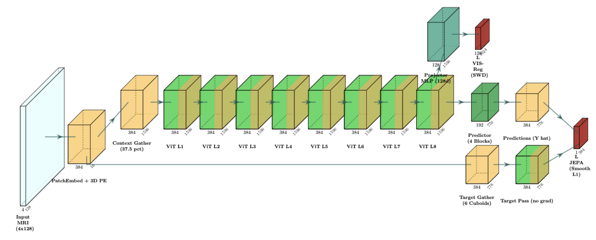
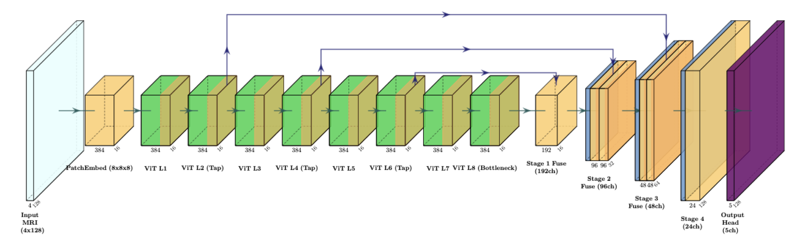
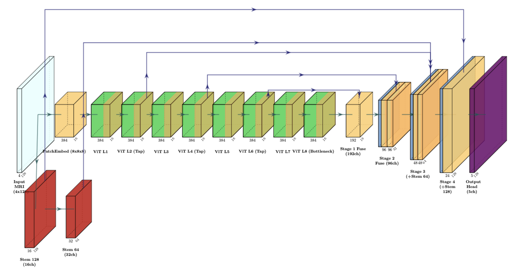
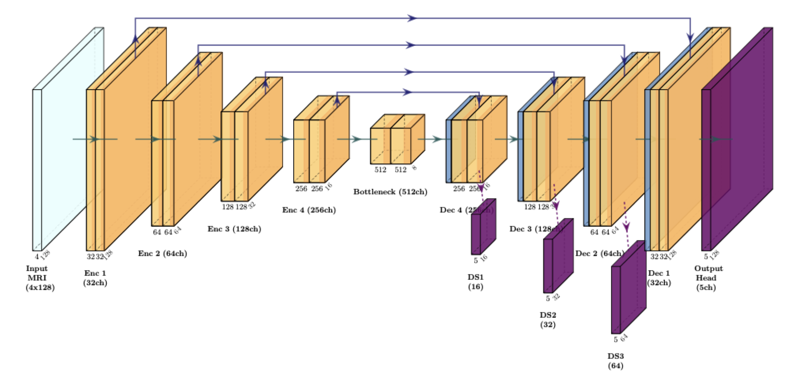
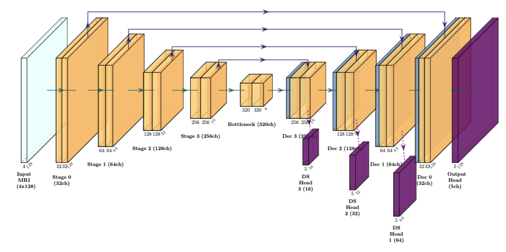

# 3D BraTS Model Architectures: Layer-by-Layer ASCII Graphs

This document details the exact layer topologies, tensor dimensions, skip connections, and parameter distributions across all models in the repository.

---

## Table of Contents
1. [Single-Encoder JEPA 3D (Pre-Training Architecture)](#1-single-encoder-jepa-3d-pre-training-architecture)
2. [ViT Transformer Block Internal Micro-Architecture](#2-vit-transformer-block-internal-micro-architecture)
3. [Downstream Probe 1: ViT + Multi-Scale FPN Decoder](#3-downstream-probe-1-vit--multi-scale-fpn-decoder)
4. [Downstream Probe 2: ViT + Hybrid UNETR Decoder](#4-downstream-probe-2-vit--hybrid-unetr-decoder)
5. [Supervised Baseline 1: 3D Residual UNet](#5-supervised-baseline-1-3d-residual-unet)
6. [Supervised Baseline 2: 3D nnU-Net (DynUNet)](#6-supervised-baseline-2-3d-nnu-net-dynunet)

---

## 1. Single-Encoder JEPA 3D (Pre-Training Architecture)
*File: [`src/brats_jepa_3d/models/single_encoder_jepa_3d.py`](file:///Users/hanriman/Documents/master/thesis/thesis_3d/src/brats_jepa_3d/models/single_encoder_jepa_3d.py)*  
*Total Parameters: **19.80M** ($8^3$ patch, 4,096 tokens) / **23.24M** ($16^3$ patch, 512 tokens)*  
*Publication Diagram: [Vector PDF](figures/arch_jepa_pretrain_3d.pdf) | [TikZ Code](figures/tex/arch_jepa_pretrain_3d.tex)*



```text
========================================================================================================
                                3D MULTIMODAL SINGLE-ENCODER JEPA
========================================================================================================

                            Input Volume X ∈ R^[B × 4 × 128 × 128 × 128]
                                (T1n, T1c, T2w, T2f MRI sequences)
                                                 │
                                                 ▼
        ┌─────────────────────────────────────────────────────────────────────────────────┐
        │ 3D Patch Embedding: Conv3d(in=4, out=384, kernel=8³, stride=8³)                │
        │ Output: Z_patch ∈ R^[B × 384 × 16 × 16 × 16]                                    │
        │ Flatten & Transpose ──► Z_seq ∈ R^[B × 4096 × 384]                              │
        └────────────────────────────────────────┬────────────────────────────────────────┘
                                                 │
                                                 ▼
        ┌─────────────────────────────────────────────────────────────────────────────────┐
        │ (+) 3D Sinusoidal Coordinate Positional Embedding (Frozen, requires_grad=False) │
        │ [PE(z) || PE(y) || PE(x)] ∈ R^[1 × 4096 × 384]                                  │
        └────────────────────────────────────────┬────────────────────────────────────────┘
                                                 │
                                                 ▼
                                     Z_0 ∈ R^[B × 4096 × 384]
                                                 │
                         ┌───────────────────────┴───────────────────────┐
                         │                                               │
                         ▼ (Gradients Enabled)                           ▼ (Stop-Gradient / eval mode)
            [Context Token Selection]                         [Target Token Selection]
          3D Connected BFS Cluster (37.5%)                  6 Anisotropic Cuboids (97/776 tokens)
            N_ctx = 1536 visible tokens                       N_tgt across 6 disjoint cuboids
                         │                                               │
                         ▼                                               ▼
              Z_ctx_in ∈ R^[B × 1536 × 384]                   Y_full ∈ R^[B × 4096 × 384]
                         │                                               │
                         ▼                                               ▼
         ┌───────────────────────────────┐               ┌───────────────────────────────┐
         │     ViT ENCODER (8 Blocks)    │               │     ViT ENCODER (8 Blocks)    │
         │  LayerNorm -> MHA(6h, D=384)  │               │      (with torch.no_grad()    │
         │  LayerNorm -> MLP(D=384->1536)│               │    & dropout_disabled(enc))   │
         └───────────────┬───────────────┘               └───────────────┬───────────────┘
                         │                                               │
                         ▼                                               ▼
              Z_ctx ∈ R^[B × 1536 × 384]                      Y_tgt_full ∈ R^[B × 4096 × 384]
                         │                                               │
        ┌────────────────┴────────────────┐                              │ Gather target tokens
        │                                 │                              ▼
        ▼                                 ▼                      ┌───────────────────────────────┐
 [Auxiliary Projector]        [Predictor Context Proj]           │   Target Embeddings Y_tgt     │
 Linear(384 -> 1024)          Linear(384 -> 192)                 │    List of 6 cuboid tensors   │
 LayerNorm(1024) + GELU                   │                      │   Y_m ∈ R^[B × N_tgt_m × 384] │
 Linear(1024 -> 128)                      ▼                      └───────────────┬───────────────┘
        │                     Z_ctx_proj ∈ R^[B × 1536 × 192]                    │
        ▼                                 │                                      │
 P_ctx ∈ R^[B × 1536 × 128]               │                                      │
        │                                 │                                      │
        ▼                                 ▼                                      │
 [Tissue Filter]             ┌────────────────────────────────────────┐          │
 Select Brain Parenchyma     │  Concatenate with Target Mask Queries  │          │
 (Discard Air Background)    │  [Z_ctx_proj  ||  Mask_Token + PE_tgt] │          │
        │                    └────────────────────┬───────────────────┘          │
        ▼                                         ▼                              │
 P_tissue ∈ R^[N_tissue × 128]        Z_pred_in ∈ R^[B × (1536+N_tgt) × 192]     │
        │                                         │                              │
        │                                         ▼                              │
        │                            ┌────────────────────────┐                  │
        │                            │ PREDICTOR (4 Blocks)   │                  │
        │                            │ Pre-LN MHA (6h, D=192) │                  │
        │                            │ Pre-LN MLP (192->768)  │                  │
        │                            └────────────┬───────────┘                  │
        │                                         │                              │
        │                                         ▼                              │
        │                            LayerNorm(192)                              │
        │                            Linear(192 -> 384)                          │
        │                            Slice Target Slots Only                     │
        │                                         │                              │
        │                                         ▼                              │
        │                            Predictions Ŷ_tgt ∈ R^[B × N_tgt × 384]    │
        │                                         │                              │
        ▼                                         ▼                              ▼
┌──────────────────────────────┐        ┌────────────────────────────────────────────────┐
│   NON-COLLAPSE REGULARIZER   │        │           JEPA PREDICTION LOSS                 │
│  VISReg (Sliced-Wasserstein) │        │   L_pred = (1/M) ∑ || Ŷ_tgt_m - Y_tgt_m ||_1   │
│              OR              │        │        (Smooth-L1 / Huber loss)                │
│   SigReg (Epps-Pulley EP)    │        └───────────────────────┬────────────────────────┘
└──────────────┬───────────────┘                                │
               │                                                │
               └───────────────────────┬────────────────────────┘
                                       ▼
                       Total Loss = L_pred + λ_reg * L_reg
```

---

## 2. ViT Transformer Block Internal Micro-Architecture
*File: [`src/brats_jepa_3d/models/vision_transformer_3d.py`](file:///Users/hanriman/Documents/master/thesis/thesis_3d/src/brats_jepa_3d/models/vision_transformer_3d.py)*  
*Architecture: Pre-LayerNorm Residual Transformer Block (Xiong et al., ICML 2020)*

```text
                        Input Tokens X_in ∈ R^[B × N × D]
                                       │
                         ┌─────────────┴─────────────┐
                         │ Residual Path 1           │
                         │                           ▼
                         │                    LayerNorm(D)
                         │                           │
                         │                           ▼
                         │               Multi-Head Self-Attention
                         │            (num_heads=6, embed_dim=D)
                         │           Fast-path SDPA/FlashAttention
                         │                           │
                         │                           ▼
                         │                      Dropout(p)
                         │                           │
                         ▼                           ▼
                     [ + ] ◄─────────────────────────┘
                         │
                      X_mid ∈ R^[B × N × D]
                         │
                         ┌─────────────┴─────────────┐
                         │ Residual Path 2           │
                         │                           ▼
                         │                    LayerNorm(D)
                         │                           │
                         │                           ▼
                         │                 Feed-Forward Network (MLP)
                         │                    Linear(D -> 4*D)
                         │                           │
                         │                           ▼
                         │                         GELU()
                         │                           │
                         │                           ▼
                         │                      Dropout(p)
                         │                           │
                         │                           ▼
                         │                    Linear(4*D -> D)
                         │                           │
                         │                           ▼
                         │                      Dropout(p)
                         │                           │
                         ▼                           ▼
                     [ + ] ◄─────────────────────────┘
                         │
                         ▼
                       X_out ∈ R^[B × N × D]
```

---

## 3. Downstream Probe 1: ViT + Multi-Scale FPN Decoder
*File: [`src/brats_jepa_3d/models/segmentation_head_3d.py`](file:///Users/hanriman/Documents/master/thesis/thesis_3d/src/brats_jepa_3d/models/segmentation_head_3d.py)*  
*Decoder Type: `multiscale` (Pure Latent Probe — No raw pixel connections)*  
*Total Parameters: **24.82M** (ViT Encoder: 16.56M, Decoder: 8.27M on canonical $8^3$ patch)*  
*Publication Diagram: [Vector PDF](figures/arch_fpn_decoder_3d.pdf) | [TikZ Code](figures/tex/arch_fpn_decoder_3d.tex)*



```text
Input Volume X ∈ R^[B × 4 × 128 × 128 × 128]
       │
       ▼
[3D Patch Embedding] ──► Z_0 ∈ R^[B × 4096 × 384] (16³ spatial grid)
       │
       ▼
 ┌───────────┐
 │ ViT Layer │
 │    L_1    │
 └─────┬─────┘
       ▼
 ┌───────────┐
 │ ViT Layer │ ──► L_2 intermediate tokens (Z_2) ───────────────────────────────┐
 │    L_2    │                                                                  │
 └─────┬─────┘                                                                  │
       ▼                                                                        │
 ┌───────────┐                                                                  │
 │ ViT Layer │                                                                  │
 │    L_3    │                                                                  │
 └─────┬─────┘                                                                  │
       ▼                                                                        │
 ┌───────────┐                                                                  │
 │ ViT Layer │ ──► L_4 intermediate tokens (Z_4) ────────────────┐               │
 │    L_4    │                                                  │               │
 └─────┬─────┘                                                  │               │
       ▼                                                        │               │
 ┌───────────┐                                                  │               │
 │ ViT Layer │                                                  │               │
 │    L_5    │                                                  │               │
 └─────┬─────┘                                                  │               │
       ▼                                                        │               │
 ┌───────────┐                                                  │               │
 │ ViT Layer │ ──► L_6 intermediate tokens (Z_6) ──┐            │               │
 │    L_6    │                                     │            │               │
 └─────┬─────┘                                     │            │               │
       ▼                                           │            │               │
 ┌───────────┐                                     │            │               │
 │ ViT Layer │                                     │            │               │
 │    L_7    │                                     │            │               │
 └─────┬─────┘                                     │            │               │
       ▼                                           │            │               │
 ┌───────────┐                                     │            │               │
 │ ViT Layer │ ──► L_8 bottleneck (Z_8)            │            │               │
 │    L_8    │     Shape: [B, 384, 16, 16, 16]     │            │               │
 └───────────┘             │                       │            │               │
                           ▼                       ▼            │               │
               ┌───────────────────────┐ ┌───────────────────┐  │               │
               │ Stage 1: Conv3d       │ │ Skip L6: Conv3d   │  │               │
               │ (384 -> 192, GroupN)  │ │ (384 -> 192)      │  │               │
               └───────────┬───────────┘ └─────────┬─────────┘  │               │
                           │                       │            │               │
                           └───────────┬───────────┘            │               │
                                       ▼                        │               │
                           Concat & Fuse1 (Conv3d 384 -> 192)   │               │
                           x1 ∈ R^[B × 192 × 16 × 16 × 16]      │               │
                           (Optional DS1 tap)                   │               │
                                       │                        │               │
                                       ▼                        ▼               │
               ┌───────────────────────┐ ┌───────────────────┐  │               │
               │ Stage 2: ConvTrans3d  │ │ Skip L4: ConvTrans│  │               │
               │ (192 -> 96, stride 2) │ │ (384 -> 96, str 2)│  │               │
               └───────────┬───────────┘ └─────────┬─────────┘  │               │
                           │                       │            │               │
                           └───────────┬───────────┘            │               │
                                       ▼                        │               │
                           Concat & Fuse2 (Conv3d 192 -> 96)    │               │
                           x2 ∈ R^[B × 96 × 32 × 32 × 32]       │               │
                           (Optional DS2 tap)                   │               │
                                       │                        │               │
                                       ▼                        ▼               ▼
               ┌───────────────────────┐ ┌───────────────────────────────────┐
               │ Stage 3: ConvTrans3d  │ │ Skip L2: ConvTrans3d              │
               │ (96 -> 48, stride 2)  │ │ (384 -> 48, stride 4)             │
               └───────────┬───────────┘ └─────────────────┬─────────────────┘
                           │                               │
                           └───────────────┬───────────────┘
                                           ▼
                               Concat & Fuse3 (Conv3d 96 -> 48)
                               x3 ∈ R^[B × 48 × 64 × 64 × 64]
                               (Optional DS3 tap)
                                           │
                                           ▼
               ┌─────────────────────────────────────────────────────────────┐
               │ Stage 4: ConvTranspose3d (48 -> 24, stride 2, GroupNorm)    │
               │ x4 ∈ R^[B × 24 × 128 × 128 × 128]                           │
               └───────────────────────────┬─────────────────────────────────┘
                                           │
                                           ▼
               ┌─────────────────────────────────────────────────────────────┐
               │ Segmentation Head: Conv3d(in=24, out=5, kernel=1)           │
               └───────────────────────────┬─────────────────────────────────┘
                                           │
                                           ▼
                       Output Logits ∈ R^[B × 5 × 128 × 128 × 128]
                      (0=BG, 1=NETC, 2=SNFH, 3=ET, 4=Resection Cavity)
```

---

## 4. Downstream Probe 2: ViT + Hybrid UNETR Decoder
*File: [`src/brats_jepa_3d/models/segmentation_head_3d.py`](file:///Users/hanriman/Documents/master/thesis/thesis_3d/src/brats_jepa_3d/models/segmentation_head_3d.py)*  
*Decoder Type: `unetr_hybrid` (Dual-Stream: ViT Latents + Native Convolutional Stem)*  
*Total Parameters: **24.91M** (ViT: 16.56M, Stem: 0.09M, Decoder: 8.27M)*  
*Publication Diagram: [Vector PDF](figures/arch_unetr_decoder_3d.pdf) | [TikZ Code](figures/tex/arch_unetr_decoder_3d.tex)*



```text
               Input Volume X ∈ R^[B × 4 × 128 × 128 × 128]
                     │                                │
                     │ (ViT Path)                     │ (Convolutional Stem Path)
                     ▼                                ▼
       ┌───────────────────────────┐    ┌──────────────────────────────────┐
       │ 3D Patch Embedding (8³)   │    │ stem_128: 2× [Conv3d(4->16, k=3) │
       │ ViT Encoder (8 Layers)    │    │              + GroupNorm + GELU] │
       └─────────────┬─────────────┘    └────────────────┬─────────────────┘
                     │                                   │
                     ├──────────────┐                    ▼
                     │ (L8, L6, L4) │          f128 ∈ R^[B × 16 × 128³]
                     │              │                    │
                     ▼              │                    ▼
       ┌───────────────────────────┐│   ┌──────────────────────────────────┐
       │ Stage 1 & 2 FPN Latents   ││   │ stem_64: Conv3d(16->32, stride=2)│
       │ x2 ∈ R^[B × 96 × 32³]     ││   └────────────────┬─────────────────┘
       └─────────────┬─────────────┘│                    │
                     │              │                    ▼
                     │              │          f64 ∈ R^[B × 32 × 64³]
                     ▼              ▼                    │
         ┌───────────────────────┐ ┌─────────────────┐   │
         │ Stage 3: ConvTrans3d  │ │ Skip L2:        │   │
         │ (96 -> 48, stride 2)  │ │ ConvTrans(str=4)│   │
         └───────────┬───────────┘ └────────┬────────┘   │
                     │                      │            │
                     └──────────────┬───────┴────────────┘
                                    ▼
                      ┌───────────────────────────┐
                      │ Fuse3: Conv3d             │
                      │ Concatenate: [48 + 48 + 32]│
                      │ Output: x3 ∈ R^[B × 48 × 64³]
                      └─────────────┬─────────────┘
                                    │
                                    ▼
                      ┌───────────────────────────┐
                      │ Stage 4: ConvTrans3d      │
                      │ (48 -> 24, stride 2)      │
                      └─────────────┬─────────────┘
                                    │
                                    ├────────────────────┐
                                    │                    │
                                    ▼                    ▼
                      ┌───────────────────────────┐      │
                      │ Fuse4: Conv3d             │ ◄────┘ (f128 stem skip)
                      │ Concatenate: [24 + 16]    │
                      │ Output: x4 ∈ R^[B × 24 × 128³]
                      └─────────────┬─────────────┘
                                    │
                                    ▼
                      ┌───────────────────────────┐
                      │ Head: Conv3d(24 -> 5, k=1)│
                      └─────────────┬─────────────┘
                                    │
                                    ▼
                         Logits ∈ R^[B × 5 × 128³]
```

---

## 5. Supervised Baseline 1: 3D Residual UNet
*File: [`src/brats_jepa_3d/models/unet_3d.py`](file:///Users/hanriman/Documents/master/thesis/thesis_3d/src/brats_jepa_3d/models/unet_3d.py)*  
*Total Parameters: **19.23M** (with Deep Supervision default-ON)*  
*Publication Diagram: [Vector PDF](figures/arch_unet_3d.pdf) | [TikZ Code](figures/tex/arch_unet_3d.tex)*



```text
Input Volume X ∈ R^[B × 4 × 128 × 128 × 128]
       │
       ▼
┌────────────────────────────────────────┐
│ Encoder Stage 1: Channels = 32         │ ─── [Skip 1: 32ch, 128³] ───────────────────────────────────────┐
│ 2× Residual Units (Conv3d + InstNorm)  │                                                                 │
└──────────────────┬─────────────────────┘                                                                 │
                   │ Stride 2                                                                              │
                   ▼                                                                                       │
┌────────────────────────────────────────┐                                                                 │
│ Encoder Stage 2: Channels = 64         │ ─── [Skip 2: 64ch, 64³] ─────────────────────┐                  │
│ 2× Residual Units                      │                                              │                  │
└──────────────────┬─────────────────────┘                                              │                  │
                   │ Stride 2                                                           │                  │
                   ▼                                                                    │                  │
┌────────────────────────────────────────┐                                              │                  │
│ Encoder Stage 3: Channels = 128        │ ─── [Skip 3: 128ch, 32³] ──┐                 │                  │
│ 2× Residual Units                      │                            │                 │                  │
└──────────────────┬─────────────────────┘                            │                 │                  │
                   │ Stride 2                                         │                 │                  │
                   ▼                                                  │                 │                  │
┌────────────────────────────────────────┐                            │                 │                  │
│ Encoder Stage 4: Channels = 256        │ ─── [Skip 4: 256ch, 16³] ┐ │                 │                  │
│ 2× Residual Units                      │                          │ │                 │                  │
└──────────────────┬─────────────────────┘                          │ │                 │                  │
                   │ Stride 2                                       │ │                 │                  │
                   ▼                                                │ │                 │                  │
┌────────────────────────────────────────┐                          │ │                 │                  │
│ Bottleneck Stage 5: Channels = 512     │                          │ │                 │                  │
│ 2× Residual Units (16³ -> 8³)          │                          │ │                 │                  │
└──────────────────┬─────────────────────┘                          │ │                 │                  │
                   │ Up-convolution (512 -> 256)                    │ │                 │                  │
                   ▼                                                │ │                 │                  │
┌────────────────────────────────────────┐                          │ │                 │                  │
│ Decoder Stage 4: Concat [256 + 256]    │ ◄────────────────────────┘ │                 │                  │
│ 2× Residual Units -> 256ch (16³)       │                            │                 │                  │
└──────────────────┬─────────────────────┘                            │                 │                  │
                   ├─────────────────────────────────► ds1 (1×1×1 Conv ──► 5ch Logits @ 16³)               │
                   │ Up-convolution (256 -> 128)                      │                 │                  │
                   ▼                                                  │                 │                  │
┌────────────────────────────────────────┐                            │                 │                  │
│ Decoder Stage 3: Concat [128 + 128]    │ ◄──────────────────────────┘                 │                  │
│ 2× Residual Units -> 128ch (32³)       │                                              │                  │
└──────────────────┬─────────────────────┘                                              │                  │
                   ├─────────────────────────────────► ds2 (1×1×1 Conv ──► 5ch Logits @ 32³)               │
                   │ Up-convolution (128 -> 64)                                         │                  │
                   ▼                                                                    │                  │
┌────────────────────────────────────────┐                                              │                  │
│ Decoder Stage 2: Concat [64 + 64]      │ ◄────────────────────────────────────────────┘                  │
│ 2× Residual Units -> 64ch (64³)        │                                                                 │
└──────────────────┬─────────────────────┘                                                                 │
                   ├─────────────────────────────────► ds3 (1×1×1 Conv ──► 5ch Logits @ 64³)               │
                   │ Up-convolution (64 -> 32)                                                             │
                   ▼                                                                                       │
┌────────────────────────────────────────┐                                                                 │
│ Decoder Stage 1: Concat [32 + 32]      │ ◄───────────────────────────────────────────────────────────────┘
│ 2× Residual Units -> 32ch (128³)       │
└──────────────────┬─────────────────────┘
                   │
                   ▼
┌────────────────────────────────────────┐
│ Final Output Head: Conv3d(32 -> 5, 1³) │
└──────────────────┬─────────────────────┘
                   │
                   ▼
         Full Logits ∈ R^[B × 5 × 128³]
```

---

## 6. Supervised Baseline 2: 3D nnU-Net (DynUNet)
*File: [`src/brats_jepa_3d/models/nnunet_3d.py`](file:///Users/hanriman/Documents/master/thesis/thesis_3d/src/brats_jepa_3d/models/nnunet_3d.py)*  
*Total Parameters: **22.75M** (Self-Configuring Biomedical Baseline, Deep Supervision Default-ON)*  
*Publication Diagram: [Vector PDF](figures/arch_nnunet_3d.pdf) | [TikZ Code](figures/tex/arch_nnunet_3d.tex)*



```text
Input Volume X ∈ R^[B × 4 × 128 × 128 × 128]
       │
       ▼
┌────────────────────────────────────────┐
│ Stage 0: Filters = 32, Stride = (1,1,1)│ ─── [Skip 0: 32ch, 128³] ────────────────────────────────────────┐
│ Residual Conv Block + InstanceNorm     │                                                                  │
└──────────────────┬─────────────────────┘                                                                  │
                   │ Stride (2,2,2)                                                                         │
                   ▼                                                                                        │
┌────────────────────────────────────────┐                                                                  │
│ Stage 1: Filters = 64, Stride = (2,2,2)│ ─── [Skip 1: 64ch, 64³] ──────────────────────┐                  │
│ Residual Conv Block + InstanceNorm     │                                               │                  │
└──────────────────┬─────────────────────┘                                               │                  │
                   │ Stride (2,2,2)                                                              │                  │
                   ▼                                                                             │                  │
┌────────────────────────────────────────┐                                               │                  │
│ Stage 2: Filters = 128,Stride = (2,2,2)│ ─── [Skip 2: 128ch, 32³] ──┐                  │                  │
│ Residual Conv Block + InstanceNorm     │                            │                  │                  │
└──────────────────┬─────────────────────┘                            │                  │                  │
                   │ Stride (2,2,2)                                   │                  │                  │
                   ▼                                                  │                  │                  │
┌────────────────────────────────────────┐                            │                  │                  │
│ Stage 3: Filters = 256,Stride = (2,2,2)│ ─── [Skip 3: 256ch, 16³] ┐ │                  │                  │
│ Residual Conv Block + InstanceNorm     │                          │ │                  │                  │
└──────────────────┬─────────────────────┘                          │ │                  │                  │
                   │ Stride (2,2,2)                                 │ │                  │                  │
                   ▼                                                │ │                  │                  │
┌────────────────────────────────────────┐                          │ │                  │                  │
│ Bottleneck: Filters = 512, (2,2,2)     │                          │ │                  │                  │
│ Residual Conv Block (8³)               │                          │ │                  │                  │
└──────────────────┬─────────────────────┘                          │ │                  │                  │
                   │ Upsample Conv (2,2,2)                          │ │                  │                  │
                   ▼                                                │ │                  │                  │
┌────────────────────────────────────────┐                          │ │                  │                  │
│ Decoder Stage 3: Concat [256 + 256]    │ ◄────────────────────────┘ │                  │                  │
│ Residual Block -> 256ch (16³)          │                            │                  │                  │
└──────────────────┬─────────────────────┘                            │                  │                  │
                   ├─────────────────────────────────► Deep Supervision Head 3 (1×1×1 Conv ──► 5ch @ 16³)   │
                   │ Upsample Conv (2,2,2)                            │                  │                  │
                   ▼                                                  │                  │                  │
┌────────────────────────────────────────┐                            │                  │                  │
│ Decoder Stage 2: Concat [128 + 128]    │ ◄──────────────────────────┘                  │                  │
│ Residual Block -> 128ch (32³)          │                                               │                  │
└──────────────────┬─────────────────────┘                                               │                  │
                   ├─────────────────────────────────► Deep Supervision Head 2 (1×1×1 Conv ──► 5ch @ 32³)   │
                   │ Upsample Conv (2,2,2)                                               │                  │
                   ▼                                                                     │                  │
┌────────────────────────────────────────┐                                               │                  │
│ Decoder Stage 1: Concat [64 + 64]      │ ◄─────────────────────────────────────────────┘                  │
│ Residual Block -> 64ch (64³)           │                                                                  │
└──────────────────┬─────────────────────┘                                                                  │
                   ├─────────────────────────────────► Deep Supervision Head 1 (1×1×1 Conv ──► 5ch @ 64³)   │
                   │ Upsample Conv (2,2,2)                                                                  │
                   ▼                                                                                        │
┌────────────────────────────────────────┐                                                                  │
│ Decoder Stage 0: Concat [32 + 32]      │ ◄────────────────────────────────────────────────────────────────┘
│ Residual Block -> 32ch (128³)          │
└──────────────────┬─────────────────────┘
                   │
                   ▼
┌────────────────────────────────────────┐
│ Full Head: 1×1×1 Conv (32 -> 5)        │ ──────────► Final Full-Resolution Output (5ch @ 128³)
└────────────────────────────────────────┘
```

---

## 7. Deep Supervision Loss Weighting Formula

For both `BraTS3DUNet`, `BraTS3DnnUNet`, and when deep supervision is active on `JEPASegmentationModel3D`, the multi-scale auxiliary heads are supervised using exponentially decaying weights ($w_s = 2^{-s} / \sum 2^{-j}$):

$$\mathcal{L}_{\text{total}} = \frac{1}{\sum_{s=0}^{S-1} 2^{-s}} \sum_{s=0}^{S-1} 2^{-s} \cdot \mathcal{L}_{\text{Dice+BCE}}\left(\hat{Y}_s, Y_s\right)$$

Where:
* $s=0$ corresponds to the full-resolution $128^3$ head (weight $\approx 0.533$)
* $s=1$ corresponds to the $64^3$ head (weight $\approx 0.267$)
* $s=2$ corresponds to the $32^3$ head (weight $\approx 0.133$)
* $s=3$ corresponds to the $16^3$ head (weight $\approx 0.067$)
