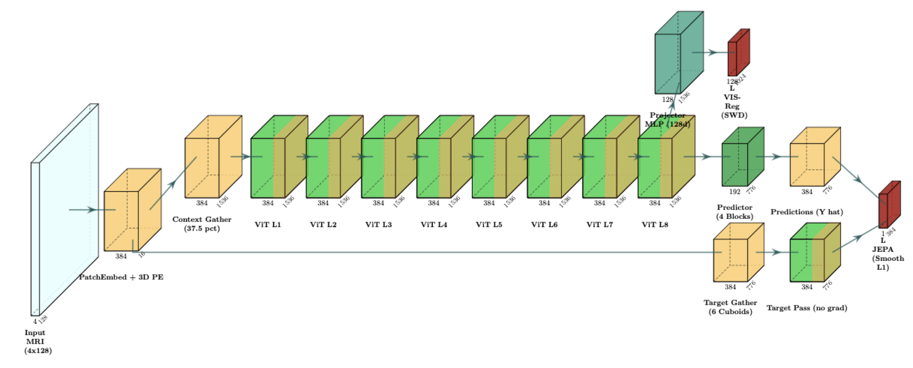
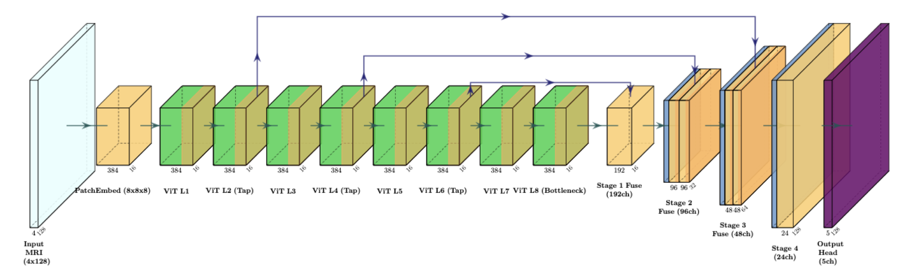
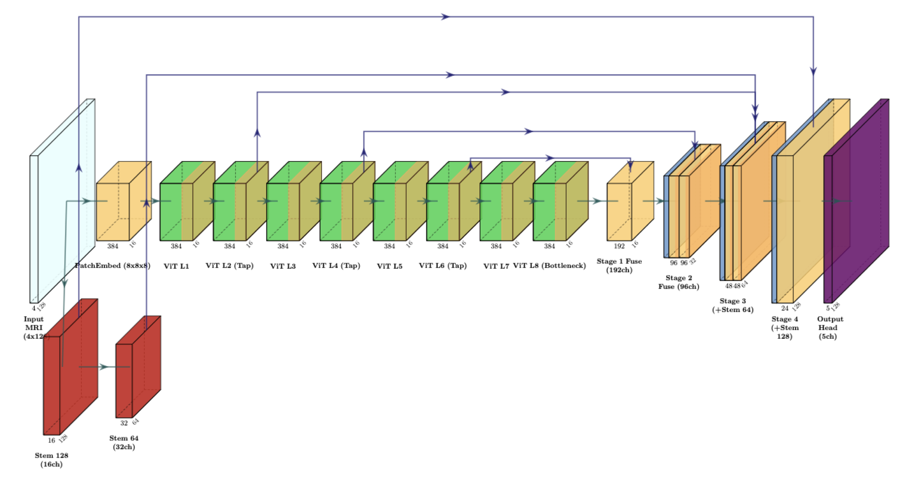
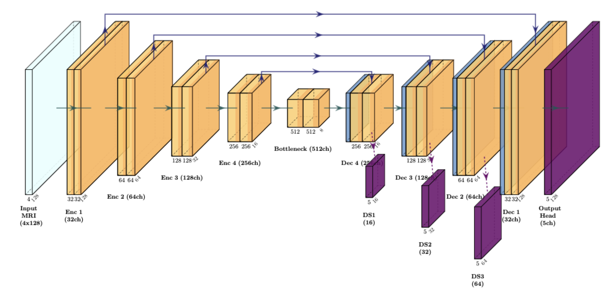
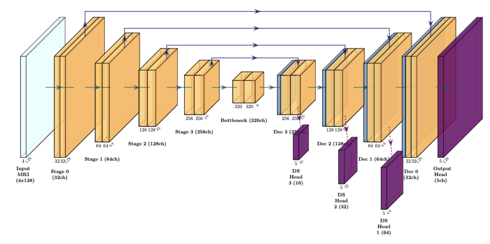

# 3D Model Architecture Figures Gallery

Publication-quality 3D isometric architecture schematics generated using [PlotNeuralNet](https://github.com/HarisIqbal88/PlotNeuralNet) and LaTeX TikZ.

Each model has:
- **300-DPI PNG** for web, README, and Markdown previews
- **Vector PDF** for print and camera-ready inclusion
- **TikZ Source Code** under [`tex/`](tex/) for reproducible LaTeX rendering

---

## 1. Single-Encoder 3D VisReg JEPA (Self-Supervised Pre-Training)

*File: [`src/brats_jepa_3d/models/single_encoder_jepa_3d.py`](../../src/brats_jepa_3d/models/single_encoder_jepa_3d.py)*  
*Parameters: **19.80M** ($8^3$ patch, 4,096 tokens) / **23.24M** ($16^3$ patch, 512 tokens)*  
*Assets: [Vector PDF](arch_jepa_pretrain_3d.pdf) | [TikZ Source](tex/arch_jepa_pretrain_3d.tex)*



### Key Architectural Characteristics:
- **Input**: 4-sequence MRI ($T_1\text{n}, T_1\text{c}, T_2\text{w}, T_2\text{f}$) @ $128 \times 128 \times 128$.
- **Patch Embedding**: 3D Conv with $8^3$ kernel and stride $8^3$, yielding $16^3 = 4,096$ patch tokens in $\mathbb{R}^{384}$.
- **Context vs. Target Masking**: 3D connected BFS component ($37.5\%$ visible tokens, $N_{\text{ctx}}=1,536$) vs. 6 anisotropic disjoint cuboids ($N_{\text{tgt}}$ tokens).
- **ViT Encoder**: 8 Transformer blocks ($D=384, H=6, \text{MLP}=1536$).
- **Predictor**: 4 Transformer blocks ($D=384, H=6$).
- **VISReg Regularization**: Direct encoder-space variance ($v=1$), covariance ($c=1$), and max-margin invariance ($\lambda=25$) over $M=1024$ random hyperplanes, completely preventing dimensional collapse without an EMA teacher.

---

## 2. ViT + Multi-Scale FPN Decoder (Primary Proposed Pure Latent Probe)

*File: [`src/brats_jepa_3d/models/segmentation_head_3d.py`](../../src/brats_jepa_3d/models/segmentation_head_3d.py)*  
*Parameters: **24.82M** (Encoder: 19.80M + FPN Decoder: 5.02M)*  
*Assets: [Vector PDF](arch_fpn_decoder_3d.pdf) | [TikZ Source](tex/arch_fpn_decoder_3d.tex)*



### Key Architectural Characteristics:
- **Zero Raw Image Skips**: Pure latent probe evaluating self-supervised volumetric representations without leaking raw intensity features.
- **Hierarchical Lateral Taps**: Intermediate feature representations extracted from Transformer layers L2, L4, L6, L8 ($16^3$ grid, 384 channels).
- **Progressive Upsampling**: 4-stage 3D transposed convolution pyramid restoring resolutions:
  - Stage 1: $16^3 \to 16^3$ (96 channels)
  - Stage 2: $16^3 \to 32^3$ (64 channels)
  - Stage 3: $32^3 \to 64^3$ (32 channels)
  - Stage 4: $64^3 \to 128^3$ (24 channels)
- **Deep Supervision**: Auxiliary heads supervise intermediate stages (16³, 32³, 64³) during training.
- **Final Head**: $1 \times 1 \times 1$ Conv3D outputting 5 channels @ $128^3$ (Background, NETC, SNFH, ET, RC).

---

## 3. ViT + Hybrid UNETR Decoder (Ablation Hybrid Probe)

*File: [`src/brats_jepa_3d/models/segmentation_head_3d.py`](../../src/brats_jepa_3d/models/segmentation_head_3d.py)*  
*Parameters: **32.74M** (Encoder: 19.80M + UNETR Decoder: 12.94M)*  
*Assets: [Vector PDF](arch_unetr_decoder_3d.pdf) | [TikZ Source](tex/arch_unetr_decoder_3d.tex)*



### Key Architectural Characteristics:
- **Dual-Stream Architecture**: Combines global ViT attention features with a local convolutional stem capturing fine voxel-level boundary gradients.
- **Native Conv Stem**: 2-stage residual Conv3D block processing raw MRI inputs directly at $128^3 \to 64^3$.
- **Lateral Deconvolutional Bridges**: Deconv3D blocks reshape Transformer taps to intermediate spatial dimensions:
  - L2: $16^3 \to 64^3$ (64 channels)
  - L4: $16^3 \to 32^3$ (128 channels)
  - L6: $16^3 \to 16^3$ (256 channels)
  - L8 (bottleneck): $16^3 \to 16^3$ (384 channels)
- **Concatenation & Fusion**: Residual Conv blocks fuse convolutional stem features with upsampled ViT representations at each resolution stage.

---

## 4. 3D Residual U-Net Supervised Baseline

*File: [`src/brats_jepa_3d/models/unet_3d.py`](../../src/brats_jepa_3d/models/unet_3d.py)*  
*Parameters: **16.32M***  
*Assets: [Vector PDF](arch_unet_3d.pdf) | [TikZ Source](tex/arch_unet_3d.tex)*



### Key Architectural Characteristics:
- **Encoder-Decoder Pyramid**: 5 stages with channel widths $(32, 64, 128, 256, 512)$ and 2 residual convolutional units per stage.
- **Normalizations**: Volumetric Instance Normalization (`InstanceNorm3d`) with PReLU activations.
- **Skip Connections**: Additive skip-merge blocks passing fine anatomical textures across resolutions.
- **Multi-Scale Deep Supervision**: Forward hooks capture auxiliary taps at $16^3, 32^3, 64^3$, projecting each via $1 \times 1 \times 1$ heads.

---

## 5. 3D nnU-Net (DynUNet) Supervised Baseline

*File: [`src/brats_jepa_3d/models/nnunet_3d.py`](../../src/brats_jepa_3d/models/nnunet_3d.py)*  
*Parameters: **31.19M***  
*Assets: [Vector PDF](arch_nnunet_3d.pdf) | [TikZ Source](tex/arch_nnunet_3d.tex)*



### Key Architectural Characteristics:
- **Dynamic U-Net Topology**: Isensee et al. Nature Methods 2021 recipe adapted for 3D multi-modal neuro-oncology.
- **Anisotropic Kernel Strides**: Channel depth sequence $(32, 64, 128, 256, 320, 320)$ with kernel sizes $((3,3,3), \dots)$.
- **Deep Supervision**: 5 auxiliary output heads with exponential resolution weighting $(0.533, 0.267, 0.133, 0.067)$.

---

## 6. Directory Structure

```
docs/figures/
├── README.md                      # Visual gallery (this document)
├── arch_jepa_pretrain_3d.png/.pdf # Single-Encoder JEPA Pre-training
├── arch_fpn_decoder_3d.png/.pdf   # ViT + Multi-Scale FPN Probe
├── arch_unetr_decoder_3d.png/.pdf # ViT + Hybrid UNETR Probe
├── arch_unet_3d.png/.pdf          # 3D Residual U-Net Baseline
├── arch_nnunet_3d.png/.pdf        # 3D nnU-Net Baseline
└── tex/                           # TikZ LaTeX Source Codes
    ├── arch_jepa_pretrain_3d.tex
    ├── arch_fpn_decoder_3d.tex
    ├── arch_unetr_decoder_3d.tex
    ├── arch_unet_3d.tex
    └── arch_nnunet_3d.tex
```
