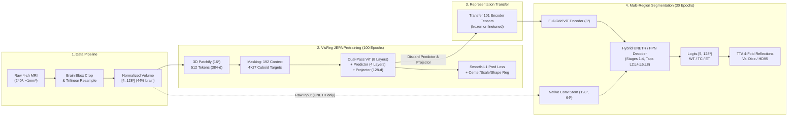
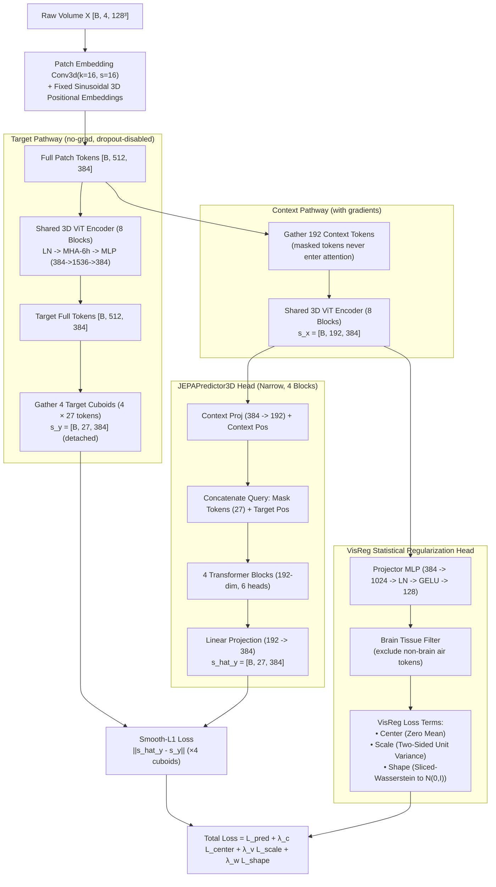
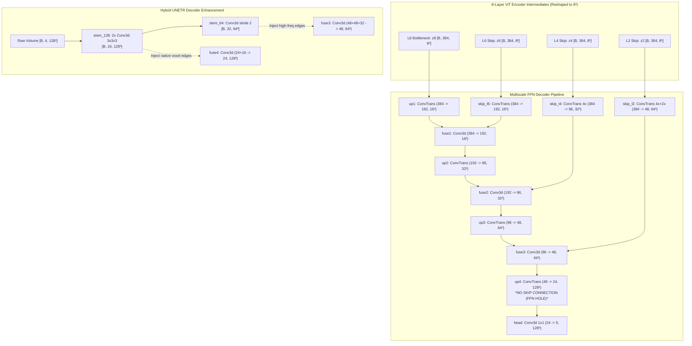

# VisReg JEPA End-to-End: Raw Scan → Pretraining → Downstream Segmentation

*Thesis reference doc. Numbers are measured on BraTS 2024 GLI (v2 pool, N=1621)
unless noted. Code refs are `thesis_3d` paths on `feat/multiregion-wt-tc-et`.*

## 0. The flow in one paragraph

Four 1mm³ MRI volumes are cropped to the brain bounding box, resampled to a
128³ cube, and normalized — yielding a `[4,128,128,128]` tensor that is ~56%
zero air. A strided convolution chops it into 512 patch-tokens (16³ voxels
each, embedded to 384 dims). Pretraining hides 4 cuboid targets (~108 tokens),
encodes the 192-token visible context, and trains a small predictor to guess
the hidden tokens' embeddings (smooth-L1) while statistical regularizers keep
the representation healthy. The predictor is then **thrown away**: only the
101 encoder tensors transfer, feeding a UNet-style decoder that outputs a
5-channel tumor mask. Supervised finetuning + TTA evaluation closes the loop.

```
RAW 240³ → BBOX crop → RESAMPLE 128³ → PATCH/16 → 512 TOKENS → MASK (192 ctx / ~108 tgt)
→ DUAL ENCODER PASS → PREDICTOR → LOSS → 101 ENCODER TENSORS → DECODER → [B,5,128³]
```




---

## 1. Raw data

BraTS 2024 GLI, ~1mm³ isotropic, per patient:

| Item | Shape | Content |
|---|---|---|
| T1n, T1c, T2w, T2f | `[~240,~240,~155]` float32 each | anatomy + contrast |
| seg | `[~240,~240,~155]` | labels `{0: bg, 1: NCR, 2: ED, 3: NET, 4: ET}` |

## 2. Preprocessing (`scripts/prepare_data_3d.py`)

1. **Brain bbox crop.** Non-zero union of the 4 modalities. Mean box ≈
   136×173×142 (varies per patient: y-span 132–202).
2. **Resample to 128³.** Images trilinear; seg **nearest + round**
   (`preserve_labels=True`) with fail-loud label validation before *and*
   after (`BRATS_GLI_LABELS = (0,1,2,3,4)`). Side effect: voxels become
   anisotropic bricks (~1.06×1.35×1.11 mm, y squeezed most) — see §8.
3. **Clean + normalize.** Zero all channels outside the resampled brain mask
   (CUT-A); per-channel z-score computed **inside the brain only**.
4. **Store** `.npz` (fp16 image, uint8 masks):
   `image [4,128,128,128]`, `mask [1,128,128,128]`, `brain_mask [1,128,128,128]`.
   Two protocols: `wt` → binary `(seg>0)`; `multiregion` → integers 0–4.

Measured on v2 (N=1621): brain = **44% of the cube** (25–52% range), tumor ≈
5% of brain. Every volume has tumor (`P(healthy)=0`); ~10–19% are ET-free
(test 9.92%).

## 3. Patchify (`models/vision_transformer_3d.py:71-82`)

Data flows through four ops — nothing branches here:

```
[B,4,128,128,128]
  │ Conv3d(4→384, k=s=16): each 16³×4 block → one 384-dim vector (43:1)
  ▼
[B,384,8,8,8]
  │ flatten(2).transpose(1,2): spatial grid → sequence (z-major)
  ▼
[B,512,384]
  │ + frozen sinusoidal [1,512,384] (128 dims/axis; grid geometry fixed forever)
  ▼
[B,512,384] positioned tokens → masking (§4) → encoder (§5) or decoder (§7)
```

Each token is a linear map of 16³×4 = 16,384 voxel values → 384 dims
(**43:1 compression before any attention**). Receptive field at entry = its
own block, non-overlapping — cross-patch mixing happens only in the 8
attention blocks (512² ≈ 262K pairs/head/layer). Physically each token is a
~17×22×18 mm brick; a 10 mm enhancing nodule fills ~⅛ of one token.
~56% of tokens are mostly air (bias+position placeholders).

---

## 3.1 3D Vision Transformer Backbone & Layer Breakdown

### 1. Detailed Layer Breakdown

```
[Input Volume: 4 × 128 × 128 × 128]
       │
       ▼ Conv3d (kernel=16, stride=16, channels: 4 → 384) + 3D Sinusoidal Position Embedding
[512 Patch Tokens × 384 dim]
       │
       ├── Block 1 (L1) ── Pre-LN MHA (6 heads) + MLP (384 → 1536 → 384) + Residuals
       ├── Block 2 (L2) ── Pre-LN MHA + MLP + Residuals  ──▶ [Tapped for Decoder Stage 3 (64³)]
       ├── Block 3 (L3) ── Pre-LN MHA + MLP + Residuals
       ├── Block 4 (L4) ── Pre-LN MHA + MLP + Residuals  ──▶ [Tapped for Decoder Stage 2 (32³)]
       ├── Block 5 (L5) ── Pre-LN MHA + MLP + Residuals
       ├── Block 6 (L6) ── Pre-LN MHA + MLP + Residuals  ──▶ [Tapped for Decoder Stage 1 (16³)]
       ├── Block 7 (L7) ── Pre-LN MHA + MLP + Residuals
       └── Block 8 (L8) ── Pre-LN MHA + MLP + Residuals  ──▶ [Tapped for Decoder Bottleneck (8³)]
       │
       ▼ Final LayerNorm (384)
[Output Context Representation: 384 dim]
```

### 2. Configuration & Parameter Specifications

| Component | Setting | Code Reference | Notes |
|:---|:---|:---|:---|
| **Encoder Depth** | 8 layers | [`vision_transformer_3d.py:173-195`](file:///Users/hanriman/Documents/master/thesis/thesis_3d/src/brats_jepa_3d/models/vision_transformer_3d.py#L173-L195) | 8 Transformer blocks with Pre-LN & residual skips |
| **Embedding Dimension ($D$)** | 384 | `embed_dim: 384` | 384 latent channels per token |
| **Attention Heads ($h$)** | 6 heads ($d_k = 64$) | `num_heads: 6` | Multi-head self-attention ($6 \times 64 = 384$) |
| **MLP Expansion Ratio** | $4\times$ ($D_{ff} = 1536$) | `mlp_ratio: 4.0` | 2-layer MLP ($384 \to 1536 \to 384$) with GELU |
| **Config File** | `encoder_depth: 8` | [`visreg_jepa_3d.yaml:8`](file:///Users/hanriman/Documents/master/thesis/thesis_3d/configs/model/visreg_jepa_3d.yaml#L8) | Master SSL pretraining model configuration |
| **Transformer Blocks Params** | $\approx 14.2\text{ M}$ parameters | 8 blocks $\times 1.77\text{ M}$ | Core transformer self-attention + MLP weights |
| **Total Encoder Params** | $\approx 20.68\text{ M}$ parameters | Including 3D patch projection | $\approx 6.29\text{ M}$ Conv3D patch embed + $0.2\text{ M}$ pos embed |
| **Total Downstream Model** | $29.4\text{ M}$ (FPN) / $32.5\text{ M}$ (UNETR) | [`segmentation_head_3d.py`](file:///Users/hanriman/Documents/master/thesis/thesis_3d/src/brats_jepa_3d/models/segmentation_head_3d.py) | Full encoder + multi-scale 3D decoders |

### 3. How the 8 Layers Are Used Downstream

In the downstream segmentation models (FPN and UNETR Hybrid), intermediate features are tapped at four uniformly spaced layers:

- **Index 1 ($L_2$):** Early spatial features $\to$ routed to $64^3$ resolution (`skip_l2` via $4\times + 2\times$ transposed convs)
- **Index 3 ($L_4$):** Mid-level features $\to$ routed to $32^3$ resolution (`skip_l4` via $4\times$ transposed convs)
- **Index 5 ($L_6$):** High-level features $\to$ routed to $16^3$ resolution (`skip_l6` via $2\times$ transposed convs)
- **Index 7 ($L_8$):** Deep bottleneck features $\to$ routed to $8^3$ resolution (`up1` trunk via $2\times$ transposed convs)

*(By comparison, the latent predictor used only during self-supervised pretraining has a depth of 4 layers with a narrower embedding dimension of 192 and $\approx 2.0\text{ M}$ parameters; the projector has 2 layers with $\approx 0.53\text{ M}$ parameters. Both are discarded upon downstream transfer.)*

### 4. Mathematical Stability & Pre-LN Residuals

Every Transformer block $l \in \{1, \dots, 8\}$ implements **Pre-LayerNorm** formulation with dual residual connections:
$$\mathbf{z}'_l = \mathbf{z}_{l-1} + \text{MHA}(\text{LN}(\mathbf{z}_{l-1}))$$
$$\mathbf{z}_l = \mathbf{z}'_l + \text{MLP}(\text{LN}(\mathbf{z}'_l))$$

- **Gradient Stability:** Avoids vanishing gradients during 3D SSL pretraining, ensuring identity gradient highway across the 8 layers.
- **Zero Attention Leakage:** When `patch_indices` are passed during pretraining context evaluation, only the 192 unmasked tokens are gathered *before* entering the transformer blocks. Attention complexity drops from $\mathcal{O}(512^2)$ to $\mathcal{O}(192^2)$ ($85.9\%$ FLOP reduction) with zero target information leakage.

---

## 4. Masking (`data/masking.py`, `JEPAMaskingTransform3D`)

On the 8³ = 512 token grid, per volume per draw:

| Set | Size | How |
|---|---|---|
| Targets | 4 cuboids × 3³ = ≤108 tokens (~21%) | uniform origins, **hard zero-overlap**, ≥14/27 brain-tokens preferred |
| Context | exactly 192 tokens (37.5%) | 26-connectivity BFS from random non-target seed, brain-preferred |
| Dark | ~212 tokens (~41%) | used by neither; coverage accumulates as masks redraw each epoch |

Defaults live in `configs/dataset/brats3d.yaml` (no CLI flags).
Tissue = brain-vs-air only — **no tumor signal enters sampling**.
Augmentations (train only, applied *before* masking): flips, Gaussian noise,
**modality dropout p=0.25** (Bernoulli per channel + non-empty fallback +
`C/keep` rescaling) — active in pretraining *and* finetuning.

## 5. Pretraining (`models/visreg_jepa_3d.py`, 100 epochs, batch 16)

One volume flows through two encoder passes (shared weights), then splits
into prediction vs regularization heads:



*(Vector PyTorch graph available at [`outputs/graphs/visreg_pretrain_annotated.svg`](file:///Users/hanriman/Documents/master/thesis/thesis_3d/outputs/graphs/visreg_pretrain_annotated.svg); model implementation in [`models/visreg_jepa_3d.py`](file:///Users/hanriman/Documents/master/thesis/thesis_3d/src/brats_jepa_3d/models/visreg_jepa_3d.py).)*


Each `TransformerBlock` preserves shape end-to-end; depth changes
representation, never dimensions. Predictor is narrow *by design* (forces
learning into the encoder; Assran et al. layout, not a flaw).

Schedule: cosine + warmup, AdamW. Val loss best **0.1148 at epoch 12**, then
flat/degrading (~0.13 at ep100). Representation trace: EffRank 75.9→74.3,
CosSim ~0.0005→−0.0001, FeatureVar 0.22→0.31.
Checkpoint: `model_state_dict` (163 tensors) + `encoder_state_dict` (101).

Measured health (independent diagnostics):
- Random-init EffRank **80.8** → trained **82.9**: no early collapse; rank
  sits at init level, learning happens within the subspace.
- Predictor beats IDW-smoothing **1.56× overall** (bg 1.63×, boundary 1.35×):
  pretext nontrivial, including on background.

## 6. Transfer (the narrow bridge)

`load_pretrained_encoder` strips prefixes and loads exactly the **101 encoder
tensors** into the downstream ViT encoder (identical architecture).
**Predictor + projector are discarded** — the component trained to *do* the
pretext task does not transfer; only representations cross. (101 keys matched
in every finetune log; `--freeze_encoder` sets `requires_grad=False` + eval
mode + no-grad encode, verified at runtime: 0.0 weight drift.)

## 7. Downstream (`models/segmentation_head_3d.py`, 30 epochs, batch 2, LR 3e-4)

Same `[B,4,128,128,128]` in → full-grid encoder forward with
`return_intermediate=True` → 8 intermediates `[B,512,384]`; taps z2=L2,
z4=L4, z6=L6, z8=L8 (idx 1,3,5,7), each reshaped `[B,384,8³]`. Then:

**FPN path** (TConv = TransposeConv k=2/s=2 + GN + GELU; B=2, C=5):

```
z8 [384,8³] ──up1──▶ [192,16³] ─┐
z6 [384,8³] ──skip──▶ [192,16³] ─┴─cat 384 → conv3³ → x1 [192,16³]
x1 ──up2──▶ [96,32³] ─┐
z4 ──skip k=4──▶ [96,32³] ─┴─cat 192 → conv → x2 [96,32³]
x2 ──up3──▶ [48,64³] ─┐
z2 ──skip ×4+×2──▶ [48,64³] ─┴─cat 96 → conv → x3 [48,64³]
x3 ──up4──▶ [24,128³] ──head 1×1──▶ logits [5,128³]   ← no full-res skip (FPN hole)
```



*(Vector PyTorch graphs: [`outputs/graphs/vit_unetr.svg`](file:///Users/hanriman/Documents/master/thesis/thesis_3d/outputs/graphs/vit_unetr.svg) and [`outputs/graphs/vit_fpn.svg`](file:///Users/hanriman/Documents/master/thesis/thesis_3d/outputs/graphs/vit_fpn.svg); code in [`models/segmentation_head_3d.py`](file:///Users/hanriman/Documents/master/thesis/thesis_3d/src/brats_jepa_3d/models/segmentation_head_3d.py).)*

Deep supervision (train only): `ds1`(x1)→`[5,16³]`, `ds2`(x2)→`[5,32³]`,
`ds3`(x3)→`[5,64³]`; loss over `[out, ds3, ds2, ds1]`.

**UNETR-hybrid path** (stages 1–2 identical): a fresh conv stem reads the raw
volume in parallel — `stem_128`: 2×conv3³ → `f128 [16,128³]`;
`stem_64`: conv s=2 → `f64 [32,64³]` — and `fuse3` takes 48+48+32 → `[48,64³]`
while a new `fuse4` cats f128 (24+16) → conv → `[24,128³]` → head. The stem
fills exactly the FPN hole with native edge maps where single-voxel ET
boundaries are decided (84.84 vs 80.96 with identical tokens).


- Loss `dice_bce` (bg-**excluded** Dice + full-voxel CE) + deep supervision.
  Selection: **mean WT/TC/ET val Dice** (v2; WT-only is blind to ET collapse)
  / val Dice (binary).
- Eval battery (all TTA 4-fold reflection-averaged; multiclass via
  softmax-average): master test (N=242, per-region + tumor-only columns),
  low-data retrains (1–100%), OOD (Rician σ=0.08, B1 bias, T1c-only,
  FLAIR-only).

## 8. Caveats to cite

- **HD95 "mm" are voxels.** Spacing defaults to (1,1,1); true factors are
  ~1.06×1.35×1.11 with per-patient jitter. Rankings valid (same ruler),
  literature-mm comparisons invalid. The eval supports per-volume
  `voxel_spacing` if absolute values are ever needed.
- **ET-free volumes:** ~10–19% per split. Empty-correct scores 1.0 (BraTS
  convention); report all-volume *and* tumor-only columns (tables do).
- **Low-data floor signature:** an all-empty predictor scores
  ET-mean ≈ P(ET-free) (test: exactly 9.92%) and WT/TC 0.00% (no healthy
  volumes in v2). Recognize degeneracy before claiming learning at 1%.
- **Binary↔multiregion WT incomparable strictly:** binary test had healthy
  volumes (empty→1.0 inflates WT); v2 test is all-tumor.
- **Binary JEPA checkpoints are pool-UNVERIFIED** (no `pool_fingerprint`,
  legacy): pilot status only, never in thesis tables. v2 pool fingerprint
  `6c898967610a` (1621 rows: 1144/235/242) — record per archive.

---

## 9. Shape cheat-sheet (all detail now inline in §§3–7)

```
pretrain : [B,4,128³] → [B,512,384] → ctx [B,192,384] / tgt 4×[B,27,384]
         → pred [B,27,384] ×4  +  proj [B,192,128]
transfer : 101 encoder tensors (predictor + projector discarded)
FPN      : [B,384,8³] → [B,192,16³] → [B,96,32³] → [B,48,64³] → [B,24,128³] → [B,5,128³]
UNETR    : same until 64³, + stem f128 [B,16,128³] / f64 [B,32,64³] fused at stages 3–4
```

(B=16 pretrain, B=2 downstream on Kaggle.)
